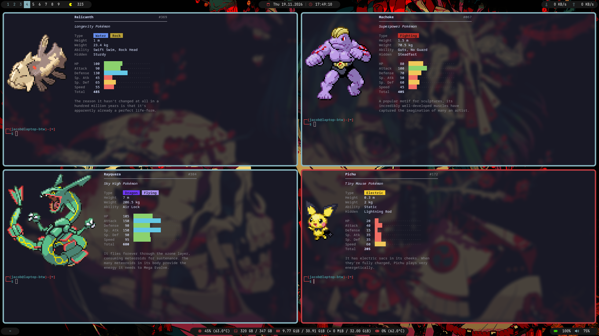

# pokefetch

Shows a random Pokémon sprite in the terminal using the kitty graphics protocol, followed by its stats.



## Usage

```
cargo run --release                 # random Pokémon
cargo run --release -- pikachu      # by name
cargo run --release -- 6 --scale 3  # by number, 3x size
```

Works in terminals that support the kitty graphics protocol (kitty, Ghostty, WezTerm, Konsole, etc.). Use `--no-image` to show only the stats.

## Build and runtime options

| Variable | When | Purpose |
|---|---|---|
| `POKEFETCH_OFFLINE_DIR` | build | Copy the assets from this directory instead of downloading them |
| `POKEFETCH_ASSET_DIR` | runtime | Read the assets from here instead of the build directory |

After `cargo install` (which deletes its build directory) or `cargo clean`, rebuild, set `POKEFETCH_ASSET_DIR`, or use `--features embed` for a self-contained binary you keep to yourself.

## Data and copyright

This repository contains **no Pokémon assets**, only original code. At build time, `build.rs` downloads:

- the HeartGold/SoulSilver sprite sheet from [veekun](https://veekun.com/dex/downloads)
- `pokedex.json` from [Purukitto/pokemon-data.json](https://github.com/Purukitto/pokemon-data.json)

The files are saved in Cargo's `OUT_DIR` (inside `target/`, which git ignores). Pokémon and all related names, sprites and data are copyright Nintendo, Creatures Inc. and GAME FREAK inc. / The Pokémon Company. Neither source grants a redistribution license. This is an unofficial fan project with no affiliation to any of those companies.

**Don't share binaries built with `--features embed`.** That feature copies the assets into the executable. The default build only stores the path to the files.